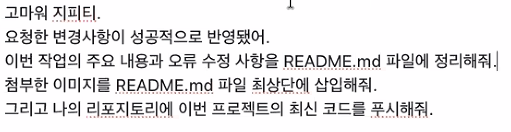

# 알로하, 이웃의 지혜

하와이의 풍경과 함께 매일 한 문장의 지혜를 감상하는 모바일 우선 정적 PWA입니다. 첨부된 비공식 창작 문장 30개만 사용하며, 공식 캐릭터 이미지·로고·영화 장면·실제 작품 대사는 포함하지 않습니다.

## 이번 작업의 주요 내용

- 날짜별로 고정되는 오늘의 명언을 구현했습니다.
- 명언 본문·주제·태그 검색과 데이터 기반 주제 필터를 구현했습니다.
- 홈·목록·상세·즐겨찾기 화면의 상태가 즉시 동기화됩니다.
- 즐겨찾기, 테마, 날짜별 명언 배정을 브라우저 `localStorage`에 저장합니다.
- 명언 상세 화면과 브라우저 뒤로 가기를 지원합니다.
- Web Share API 기반 텍스트 공유와 미지원 환경의 클립보드 복사를 지원합니다.
- 현재 배경을 포함한 1080×1350 PNG 명언 카드 저장 기능을 구현했습니다.
- 즐겨찾기 JSON 내보내기·검증·중복 병합 가져오기를 구현했습니다.
- 기기 설정·밝게·어둡게 테마를 지원합니다.
- 설치용 매니페스트, 192px·512px 아이콘, 서비스 워커 오프라인 캐시를 추가했습니다.
- 모바일 하단 탭, 키보드 포커스, 스크린 리더 레이블, 모션 감소 설정을 반영했습니다.

## 배경 이미지 변경

`imagegen`을 사용해 하와이 와이키키와 다이아몬드 헤드를 배경으로, 밝게 웃으며 손을 흔드는 성인 한국인 여성 한 명을 오른쪽에 배치한 세로형 이미지를 제작했습니다. 명언과 UI가 놓이는 왼쪽·중앙에는 충분한 여백을 확보했습니다.

- 앱 적용 이미지: `assets/backgrounds/hawaii-korean-woman-v4.webp`
- 고해상도 원본: `assets/backgrounds/hawaii-korean-woman-v4.png`
- 이전 배경도 비교와 복구를 위해 `assets/backgrounds/`에 보존했습니다.

## 오류 수정 및 개선

- 명언 카드의 즐겨찾기 버튼이 화면 우측 상단에 겹치던 위치 기준 문제를 수정했습니다.
- 첨부 데이터의 `approved-original` 권리 상태를 승인된 창작 데이터로 안전하게 검증하도록 보완했습니다.
- 첨부 데이터에 캐릭터 필드가 없는 점을 반영해 필터를 실제 데이터의 `theme` 값으로 자동 구성했습니다.
- 존재하지 않는 명언 ID 접근 시 명언집 화면으로 안내하도록 처리했습니다.
- 잘못된 백업 JSON이 기존 사용자 데이터를 변경하지 않도록 검증 절차를 추가했습니다.
- 저장소 접근 실패, 공유 취소, 서비스 워커 등록 실패가 앱 전체 실행을 막지 않도록 예외 처리를 추가했습니다.
- 배경 이미지를 WebP로 최적화하고 서비스 워커 캐시를 `v4`로 갱신했습니다.
- 44px 이상의 터치 영역, 명확한 포커스 표시, `aria-label`을 적용했습니다.

## 시범 테스트 결과

Playwright 기반 모바일 브라우저 테스트를 통과했습니다.

| 검증 항목 | 결과 |
|---|---|
| 같은 날짜의 오늘의 명언 유지 | 통과 |
| 즐겨찾기 저장 및 재실행 후 복원 | 통과 |
| “용기” 검색 | 7개 결과 |
| 검색과 주제 필터 동시 적용 | 6개 결과 |
| 명언 상세 화면 | 통과 |
| PNG 이미지 카드 다운로드 | 통과 |
| 다크 테마 저장 | 통과 |
| JSON 백업 다운로드 | 통과 |
| 잘못된 명언 주소 처리 | 통과 |
| 오프라인 재실행 | 통과 |
| 버튼 접근성 이름 | 통과 |
| 브라우저 콘솔 오류 | 없음 |

테스트 파일은 `tests/smoke.cjs`와 `tests/e2e.cjs`입니다.

## 실행 방법

`file://`로 직접 열지 말고 프로젝트 루트에서 정적 서버를 실행합니다.

```powershell
python -m http.server 4173
```

브라우저에서 [http://localhost:4173](http://localhost:4173)을 엽니다.

## 프로젝트 구조

```text
index.html
manifest.webmanifest
service-worker.js
assets/
  backgrounds/
  icons/
  readme/
data/
  quotes.json
src/
  main.js
  router.js
  quotes.js
  storage.js
  ui.js
  share.js
  backup.js
styles/
  tokens.css
  app.css
tests/
  smoke.cjs
  e2e.cjs
```

## 저작권 안내

비공식 팬 프로젝트이며 Marvel 또는 Sony와 관련이 없습니다. 모든 명언은 실제 작품의 대사가 아닌 비공식 창작 문장입니다. 배경 이미지도 이 앱을 위해 새로 생성한 오리지널 이미지이며, 특정 인물이나 유명인의 외모를 사용하지 않았습니다.
